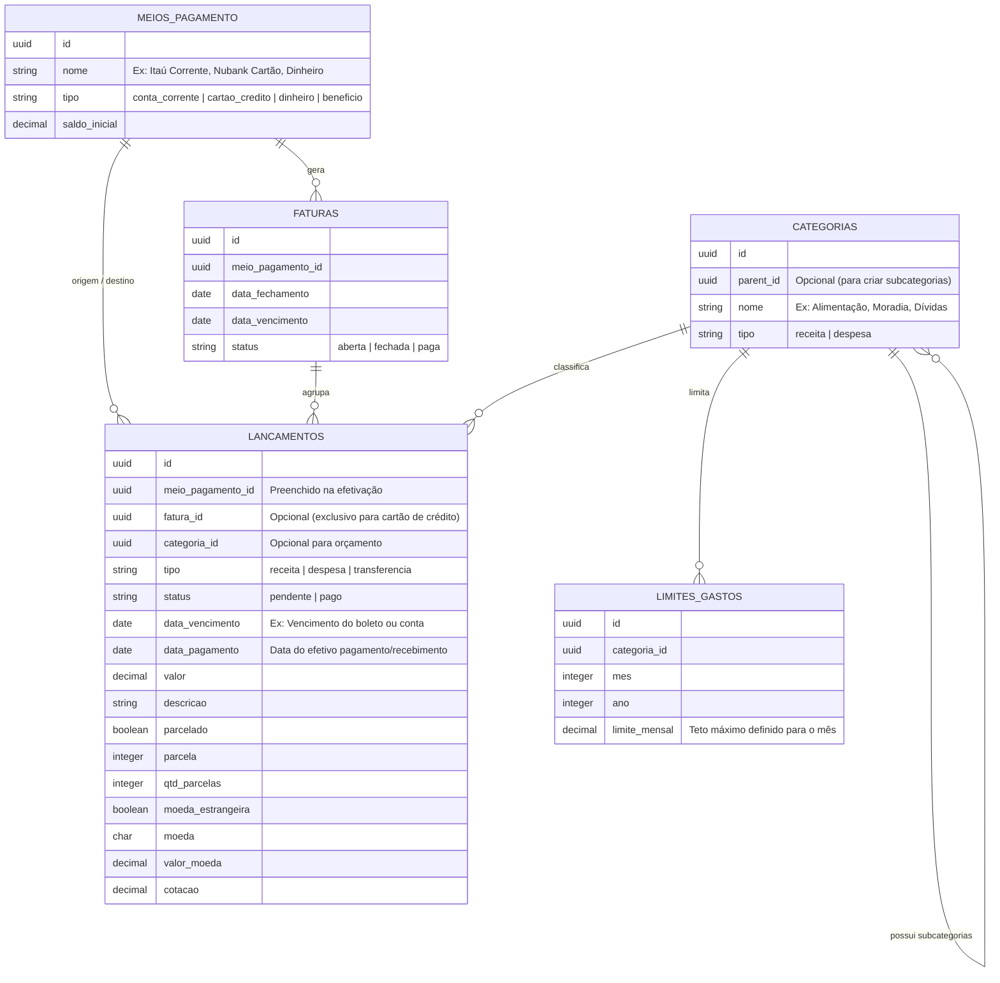

# Controle Financeiro

Aplicação para quem quer organizar a vida financeira. Ela importa extratos e faturas dos bancos, salva os lançamentos no banco de dados e permite categorizá-los, preparando o terreno para a visualização dos gastos.

> Status: ainda **sem interface gráfica**. Hoje o projeto cobre o modelo de dados, a importação de arquivos e a exportação para Excel. A visualização será construída depois.

## O que o projeto resolve

- **Centraliza** contas, cartões, dinheiro e benefícios em um só lugar.
- **Evita digitação manual:** importa os arquivos que os próprios bancos fornecem.
- **Categoriza os gastos** (com subcategorias) para mostrar para onde o dinheiro está indo.
- **Controla o orçamento** com limites mensais de gasto por categoria.
- **Cobre o dia a dia real:** contas a pagar (pendentes), parcelamentos e compras em moeda estrangeira.

## Importação de arquivos

| Origem            | Tipo de documento | Banco   |
|-------------------|-------------------|---------|
| Extrato da conta  | Extrato           | Itaú    |
| Extrato da conta  | Extrato           | Bradesco |
| Fatura do cartão  | Fatura            | Itaú    |
| Fatura do cartão  | Fatura            | Nubank  |

Cada arquivo importado vira registros em `lancamentos`, ligados ao meio de pagamento e, no caso de cartão de crédito, à fatura correspondente.

### Como funciona

A importação segue o padrão de uma classe base com a lógica comum e uma classe por formato de arquivo:

```
LancamentoImportBase     # lógica comum (normalização, gravação dos lançamentos)
├── LancamentoImportExcel   # arquivos .xls (ex.: fatura detalhada do Itaú)
└── LancamentoImportCsv     # arquivos .csv (ex.: fatura do Nubank: date, title, amount)
```

O command `faturas:importar` lê os arquivos do storage e direciona cada um para o importador correto de acordo com o tipo (mime) do arquivo.

```bash
php artisan faturas:importar
```

> TODO: confirmar se os extratos do Itaú e do Bradesco já passam por esse mesmo fluxo e se o command aceita argumentos (arquivo, meio de pagamento, titular).

## Modelo de dados



### Entidades

| Entidade          | Papel |
|-------------------|-------|
| `meios_pagamento` | Onde o dinheiro está ou por onde sai: conta corrente, cartão de crédito, dinheiro ou benefício. Guarda o saldo inicial. |
| `faturas`         | Fatura de um cartão de crédito, com datas de fechamento e vencimento e status (`aberta`, `fechada`, `paga`). |
| `categorias`      | Classificação de receitas e despesas. Pode ter subcategorias através de `parent_id`. |
| `lancamentos`     | Cada movimentação financeira: receita, despesa ou transferência. |
| `limites_gastos`  | Teto mensal de gasto por categoria, definido por mês e ano. |

### Regras do modelo

- Um lançamento nasce `pendente` (ex.: boleto a vencer) e passa a `pago` quando é efetivado; nesse momento são preenchidos `meio_pagamento_id` e `data_pagamento`.
- `fatura_id` só é usado em lançamentos de cartão de crédito.
- `categoria_id` é opcional; lançamentos sem categoria aparecem como "Sem Categoria" nos relatórios.
- Compras parceladas usam `parcelado`, `parcela` e `qtd_parcelas`.
- Compras em moeda estrangeira guardam `moeda`, `valor_moeda` e `cotacao`, além do `valor` convertido.
- Os identificadores são UUIDs.

## Exportação para Excel

O projeto gera uma planilha Excel com três abas:

- **Faturas**
- **Lançamentos**
- **Dashboard:** resumo por categoria, com gráfico de pizza do percentual sobre o total do mês selecionado.

> TODO: confirmar o comando ou a rota que dispara a exportação e os filtros disponíveis (mês, titular).

## Tecnologias

- Laravel (PHP)
- Laravel Excel (Maatwebsite) / PhpSpreadsheet para importação e exportação

> TODO: confirmar versões (PHP, Laravel) e o banco de dados utilizado.

## Instalação

```bash
git clone <url-do-repositorio> financeiro
cd financeiro

composer install
cp .env.example .env
php artisan key:generate
php artisan migrate
```

> TODO: ajustar se o projeto roda em Docker (por exemplo, via Harbor) e informar em qual pasta do storage os arquivos para importação devem ser colocados.

## Roadmap

- [ ] Interface gráfica para visualização dos gastos por categoria
- [ ] Acompanhamento dos limites mensais por categoria
- [ ] Dashboard de saldo por meio de pagamento
- [ ] Novos bancos e formatos de importação

## Contribuindo

1. Crie uma branch a partir de `main`.
2. Para um novo banco ou formato, crie uma classe de importação que estenda `LancamentoImportBase`.
3. Atualize este README ao adicionar bancos, entidades ou comandos.

## Licença

> TODO: definir.